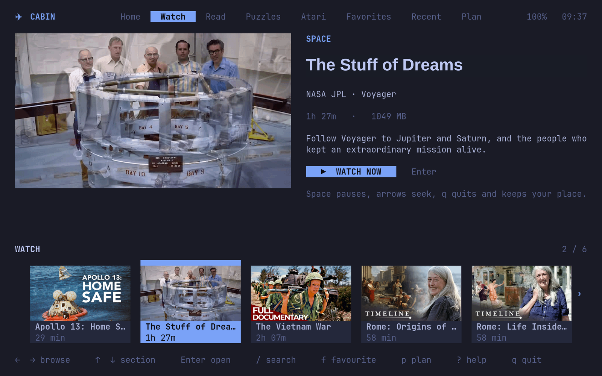

# Cabin TUI



Offline flight entertainment in a terminal, laid out like a console's big-screen
mode: full-screen, large type, artwork for whatever is selected and a shelf of
cards to browse with the arrow keys. Films, audio, magazines, puzzles and
Atari ST games in one place.

It is a front end only: you bring the films, magazines and games, and describe
them in a JSON [catalogue](#catalogue). It was written as a companion to a
desktop app called Cabin and reads the same catalogue, so the two share
favourites and the recent list. Python standard library only; nothing in it
uses the network.

## Install and run

```sh
bin/install          # links ~/.local/bin/cabin-tui and adds a launcher entry
cabin-tui --window   # its own fullscreen window with large type (what the launcher entry runs)
cabin-tui            # in the terminal you are already in
```

Needs Linux and Python 3.10 or later, with no Python packages to install. What
you open needs its player: `mpv` for films, `evince` for magazines, `hatari`
for Atari ST games and Simon Tatham's `puzzles`. Players are run from
`/usr/bin`, which is where Arch Linux puts them; the app was built and tested
on Omarchy (Arch, Hyprland).

Pictures and the large titles need a terminal that draws sixel images (foot
does) and ImageMagick. Without them, or with `--no-art`, the same layout shows
text only. `--window` uses foot; set `CABIN_TUI_FONT_SIZE` (default 15) to
change how large everything is. Colours follow the current Omarchy theme.

On Hyprland, opening a film or game takes Cabin's window out of fullscreen;
Cabin puts its own window back in fullscreen and focus when you return. On
other compositors the window stays as the compositor leaves it.

## Keys

| Key | Does |
| --- | --- |
| Left / Right | Browse the shelf |
| Up / Down, Tab | Change section |
| PgUp / PgDn, Home / End | Jump along the shelf |
| Enter | Watch, read or play |
| `/` | Search; from Home it searches everything |
| `t` | Cycle the topic filter (Space, Roman history, ...) |
| `f` | Save or remove a favourite |
| `w` | Mark a film watched or unwatched |
| `p` | Plan a line-up for the flight time |
| `u` | Show or hide Atari games that were never boot-tested |
| `d` / `J` | Atari: next boot disk / joystick on the arrow keys |
| `r` | Reload the catalogue and theme |
| `?` / `q` | Help / quit |

## What it does for a flight

- **Battery.** Films open in mpv with hardware decoding, and the header shows
  the charge and the time left on battery.
- **Engine noise.** Films play with levelled audio, and English subtitles are
  picked up when the film has them.
- **Resume.** Quit mpv with `q` and the film keeps its place; the list shows
  the time left and Home puts started films first. A film that ran to the end
  is marked watched.
- **Planner.** `p`, then your time in the air such as `3:10`, gives the films
  that fit: started ones first, then favourites, then the rest. For a trip with
  a stop, give one time per flight (`3:40, 1:25`) and no film is split across
  the stop. The plan is kept until you make another.
- **Untested games.** Atari games whose copy was never boot-checked are hidden
  until you press `u`, so nothing surprises you in the air.

## Before you leave

```sh
cabin-tui --check        # players installed, files present and complete
cabin-tui --plan 3:10    # print a line-up without opening the interface
cabin-tui --plan 3:40,1:25 --save-plan   # two flights; keep it for the Plan section
cabin-tui --list         # ids, kinds and titles
cabin-tui --dry-run ID   # the exact command an item would run
```

`--check` exits non-zero when a player is missing, a file is missing or empty,
or a download was left unfinished (`*.part`).

## Files

| Path | What |
| --- | --- |
| `~/.local/share/cabin/library.json` | Catalogue, written by Cabin's preparation scripts (`CABIN_LIBRARY` overrides it) |
| `~/.local/state/cabin/history.json` | Favourites, recent items and the trip plan, shared with the desktop app |
| `~/.local/state/cabin-tui/state.json` | Watched films and the untested-games setting |
| `~/.local/state/mpv/watch_later/` | mpv's resume positions, read for progress |
| `~/.cache/cabin-tui/` | Pictures prepared for the terminal; safe to delete |
| `~/.local/state/atari-games/` | Writable copies of the Atari disks; the originals are never changed |

## Catalogue

The catalogue is one JSON file, a list of items, at
`~/.local/share/cabin/library.json` (or wherever `CABIN_LIBRARY` points).
[`examples/library.json`](examples/library.json) has one item of each kind.

| Field | Meaning |
| --- | --- |
| `id`, `title` | Required. The id must be unique |
| `kind` | `watch`, `read`, `puzzles`, `atari` or `listen`; decides the section and the player |
| `path` | The file to open. For `puzzles` it must be `/usr/bin/puzzles-NAME` |
| `image` | Artwork: a JPEG or PNG, any size |
| `subtitle`, `description`, `tag` | Shown next to the artwork; `tag` is also the topic filter |
| `meta` | Short label on the card, such as `29 min` or `56 pages` |
| `seconds` | Length of a film, for progress and the planner |
| `bytes` | File size, shown as MB |
| `disks`, `rom`, `folder` | Atari only: disk images in boot order, the TOS ROM, and a folder name for the writable copies |
| `verified`, `notes` | Atari only: whether this copy was boot-tested, and anything to know at the boot menu |

Paths are passed to the players as single arguments, never through a shell.

## Tests

```sh
python3 -m unittest
ruff check .
```
